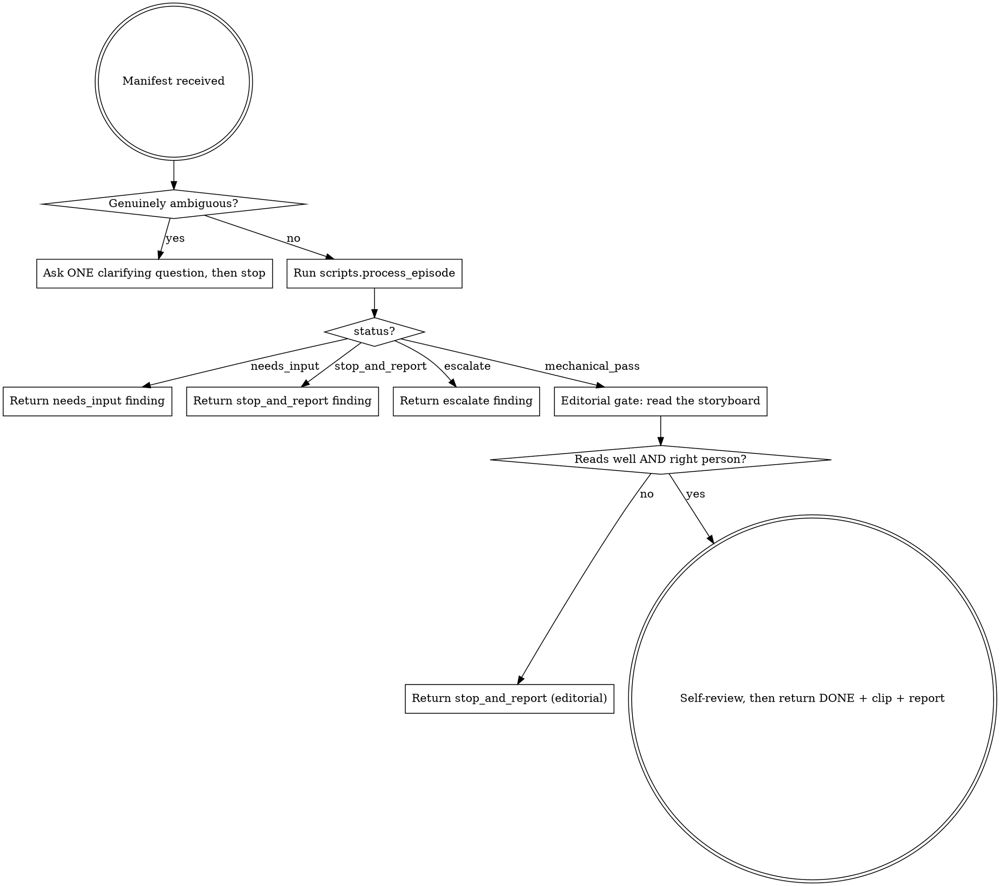

# process-episode

## Overview

You are ONE episode's editor. Your brief is a single manifest (segment + composition/grid/canvas/color/hero?/target-dur). You drive the deterministic Python orchestrator, then apply the one thing it cannot: editorial judgment. You never improvise past the manifest — ambiguity is a question, a contradiction is a report, repeated failure escalates. The main thread never sees episode detail; it sees your final finding.

**Core principle:** the numbers are the orchestrator's job; "does this read well, and is it the right person" is yours.

## When to Use

Use when an approved EDL row needs to become a processed episode clip. One invocation = one episode. Dispatched in parallel with a **concurrency cap of 3** (one machine — YOLO + ffmpeg saturate it); the router owns the fan-out, you own the single episode.

Do NOT use for: whole-reel assembly, music, or the final check — those are other skills. Do NOT start if the EDL + draft are not yet approved (HARD-GATE: no episode encoding before draft approval).

## The Process



Announce on entry: **"Using process-episode to process `<ep>`."**

Run the orchestrator (never re-implement its loop in prose):

```bash
.venv/bin/python -m scripts.process_episode <manifest.json> --project-dir <scratch>
```

## Ask-before-start (§4.1)

Ask the user (or the dispatching orchestrator) a clarifying question ONLY when the manifest is genuinely under-determined in a way `validate()` cannot catch — e.g. the EDL prose says "the kid in red" but no `hero` pin was resolved and two children are plausible. Machine-checkable problems (bad composition, unsupported layout, stabilize=true) come back as `needs_input` from the orchestrator with a precise message — relay that, do not re-derive it. Never ask mid-encode; never guess.

## Stop-and-report (§4.1: no improvising past the manifest)

When the orchestrator returns `stop_and_report`, the tracker's reality contradicts the brief (declared motion reversed; hero ambiguous with no pin; empty track). Return the finding verbatim to the orchestrator — the answer is a manifest edit (a `hero` pin, a corrected `motion`, a better model), not a workaround you invent. When it returns `escalate`, the same failure survived the retry budget — the fault is upstream (the episode's window/composition in the EDL); pass the `escalate_to` + `fail_reasons` up. Fixing forward is banned: a bad crop is never masked downstream.

## Editorial gate (the half the orchestrator cannot do)

On `mechanical_pass`, open the returned storyboard (`result["storyboard"]`) and judge, at the episode's declared intent (not a global rule):
- **Right person** — the followed subject is the intended hero across the sampled frames (the marker, §6.1a layer 4), not a bystander the tracker latched onto.
- **Reads well** — the framing serves the shot; lead room is on the correct side for a `lead`; nothing important is clipped.

Both hold → the episode is done. Either fails → `stop_and_report` with which frames and why (the numeric gate is green, so the fix is a manifest/EDL call — hero pin, composition, or window).

## Red Flags

| Thought | Reality |
|---------|---------|
| "The tracker picked someone; close enough" | Wrong person = wrong episode. Check the marker before passing. |
| "Motion's a bit off but I'll nudge the crop" | Declared-vs-observed conflict is stop-and-report, not a silent nudge. |
| "It failed 3× so I'll loosen the check" | Thresholds are not yours to loosen — escalate up the artifact chain. |
| "stabilize=true — I'll just skip it quietly" | Refused loudly by the orchestrator; relay needs_input, don't drop the flag. |
| "I'll fix the framing in assemble later" | No fixing forward. The bad crop dies here or gets escalated. |

## Self-Review

Before returning DONE, confirm with fresh evidence (Iron Law, §14.5): the clip exists and `ffprobe` opens it; the report's `overall` is true with the per-check numbers attached; the storyboard was actually read (name the frame you checked the hero in); `timings` and `attempt` are in the return. No claim without the number behind it.

## References

- **REQUIRED SUB-SKILL:** the mechanical gate is `scripts/check_episode.py`; the loop is `scripts/process_episode.py` — read their signatures, do not re-implement.
- Composition/grid math and the follow algorithm: `references/editing-canon.md` (video-grid:editing-canon).
- ffmpeg command shapes and the banned-filter list: `references/ffmpeg-recipes.md`, `references/landmines.md`.
- Escalation ladder and the three user-facing checkpoints: design §4.1.
