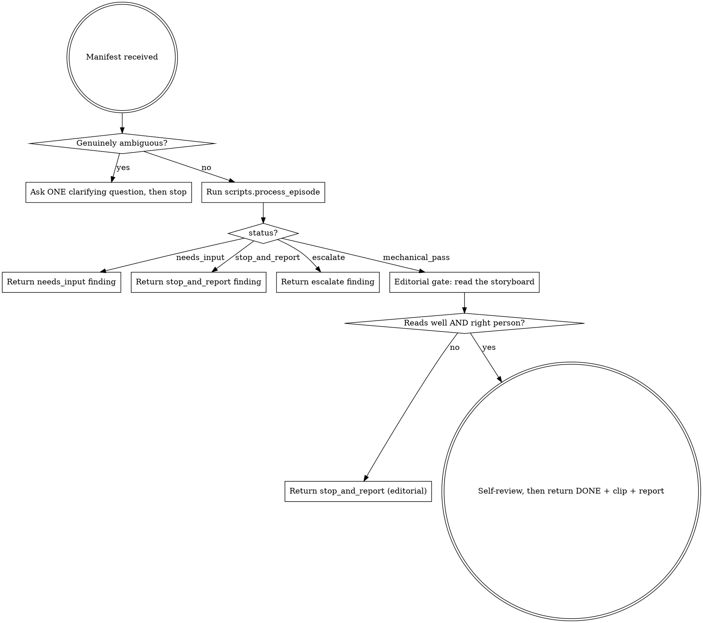

# process-episode Orchestrator (vertical slice) Implementation Plan

> **For agentic workers:** REQUIRED SUB-SKILL: Use superpowers:subagent-driven-development (recommended) or superpowers:executing-plans to implement this plan task-by-task. Steps use checkbox (`- [ ]`) syntax for tracking.

**Goal:** Build the autonomous single-episode processor — the "crown jewel" (§5.10) — that takes one episode manifest, drives the existing engine (track → reframe → storyboard → check_episode) in a retry loop, escalates on repeated failure, refuses to improvise past the manifest, and returns a structured clip+report. `fill` layout / 9:16 only; layouts and stabilization are the next plan.

**Architecture:** All determinism lives in Python and is TDD'd exactly like the core engine — pure decision helpers in `scripts/lib/` (manifest validation, contradiction detection, retry-param adjustment, escalation) + a thin imperative shell `scripts/process_episode.py` that wires the engine scripts, threads the probed `canvas`/`src_dims` contract into the checks, times each stage, and returns a machine-readable report. All *judgment* lives in the agent layer `SKILLS/process-episode/SKILL.md` — the subagent that asks-before-start on ambiguity, runs the Python orchestrator, applies the editorial gate to the storyboard, and packages stop-and-report findings. The split keeps the loop/escalation testable and the taste-calls where taste belongs.

**Tech Stack:** Python 3.13 (existing `.venv`), the shipped core engine (`scripts/extract|track|reframe|storyboard|check_episode.py`, `scripts/lib/*`, `scripts/lib/proc.py`), pytest. No new third-party deps.

**Scope boundaries (deferred on purpose — documented, not silently missing):**
- **Layouts** (`fit-blur`/`fit-solid`/`insert`/`split`/`pan`, §7) and **vidstab stabilization** (§10) → the *reframe-extensions* plan (chosen split, 2026-07-08). This slice hard-refuses them in `validate()` with a clear remedy, never half-renders.
- **Degradation ladder rungs 2–3** (optical-flow tracker, manual keyframes, §6.1) → reframe-extensions plan. This slice keeps rung 1 (YOLO); a garbage/empty track → `stop_and_report`, never a silent bad crop.
- **Descriptor continuity re-match** (§6.1a layer 3) depends on `cast.json` (ingestion plan). This slice wires the *numeric* route-continuity check (already in `check_episode`) → on fail, `stop_and_report`; descriptor re-match is out.
- **Parallel cap-3 fan-out** (`dispatching-parallel-agents`, §5.10) is the router's dispatch contract. This slice delivers the *single-episode* processor + documents the cap; it does not build a job queue.
- **Standalone `episode-postcheck` skill** (§5.11): the mechanical gate is `check_episode.py` (called by the orchestrator); the editorial gate is folded into `process-episode`'s SKILL for the slice. A separate gate skill is a later extraction.

**Repo layout produced by this plan:**
```
scripts/
├── lib/
│   ├── manifest.py       # Manifest dataclass + machine-checkable validate()
│   └── orchestration.py  # pure: contradiction detection, retry-param adjust, escalation
└── process_episode.py    # imperative shell: loop, contract threading, stage timing, report
SKILLS/
└── process-episode/
    └── SKILL.md          # the crown-jewel subagent prompt (agent judgment layer)
tests/
├── lib/
│   ├── test_manifest.py
│   └── test_orchestration.py
└── integration/
    ├── test_process_episode.py   # mocked-engine unit paths + golden end-to-end
    └── test_skill_process_episode.py  # structural check of SKILL.md
```

**Input contract — the episode manifest** (from §5.10; the dict `process_episode` receives):
```python
{
  "segment": "segments/lena_ride2_raw.mp4",  # cut fragment (extract output), REQUIRED
  "out_path": "out/lena_ride2.mp4",          # REQUIRED
  "composition": "lead",                      # lead | center | break   REQUIRED
  "grid": "thirds",                           # thirds | phi            REQUIRED
  "canvas": [9, 16],                          # [w, h]                  REQUIRED
  "target_dur": 3.3,                          # seconds                 REQUIRED
  "layout": "fill",                           # fill only this slice    (default "fill")
  "motion": "lateral:right",                  # declared; None = infer  (optional)
  "hero": null,                               # seed bbox / rule / cast name (optional)
  "color_means": [105, 122, 137],             # measured channel means  (optional, defaults)
  "stabilize": false,                         # refused this slice      (optional)
  "model": "yolo11n-seg.pt"                   # yolo size               (optional)
}
```

**Output contract — the orchestrator's return dict** (one of):
- `{"status": "mechanical_pass", "clip", "report", "storyboard", "attempt", "timings", "degraded": None}` — mechanical gate green; the SKILL applies the editorial gate next.
- `{"status": "needs_input", "problems": [...], "attempt": 0}` — manifest invalid/ambiguous *before* work starts (§4.1 ask-before-start).
- `{"status": "stop_and_report", "findings": [...], "attempt": n, ...}` — mid-task reality contradicts the manifest (§4.1 no-improvising).
- `{"status": "escalate", "escalate_to": "edit-plan", "reason", "fail_reasons", "report", "attempt", "timings"}` — retried and still failing (§4.1 3× → up the ladder).

---

## Task 0: `manifest.py` — episode manifest + validation

Pure, TDD. **Hardened post-review (commits `0cdfb97`, `dda4ae4`):** explicit JSON `null` on any field is treated as absent (defaults, not a `TypeError`); unknown/typo'd keys raise `KeyError`; `model` (enum), `color_means` length, `canvas` positivity, and non-empty `segment`/`out_path` are validated; a `hero` seed-bbox arriving as a JSON list is coerced to a tuple so the orchestrator's `isinstance(m.hero, tuple)` pin check works. The machine-checkable half of §4.1 "ask before starting if the manifest is ambiguous": missing/contradictory/unsupported fields are caught here before any ffmpeg/YOLO runs.

**Files:**
- Create: `tests/lib/test_manifest.py`
- Create: `scripts/lib/manifest.py`

- [ ] **Step 1: Write the failing tests**

`tests/lib/test_manifest.py`:
```python
import pytest
from scripts.lib import manifest as mf


def _ok_dict(**over):
    d = dict(segment="seg.mp4", out_path="out.mp4", composition="lead",
             grid="thirds", canvas=[9, 16], target_dur=3.0)
    d.update(over)
    return d


def test_from_dict_defaults():
    m = mf.Manifest.from_dict(_ok_dict())
    assert m.layout == "fill"
    assert m.stabilize is False
    assert m.color_means == (105, 122, 137)
    assert m.canvas == (9, 16)           # list coerced to tuple
    assert m.model == "yolo11n-seg.pt"


def test_from_dict_missing_required_raises():
    d = _ok_dict(); del d["composition"]
    with pytest.raises(KeyError, match="composition"):
        mf.Manifest.from_dict(d)


def test_validate_ok():
    assert mf.validate(mf.Manifest.from_dict(_ok_dict())) == []


def test_validate_unknown_composition():
    problems = mf.validate(mf.Manifest.from_dict(_ok_dict(composition="Lead")))
    assert any("composition" in p for p in problems)


def test_validate_unknown_grid():
    problems = mf.validate(mf.Manifest.from_dict(_ok_dict(grid="golden-canon")))
    assert any("grid" in p for p in problems)


def test_validate_layout_not_fill_refused():
    problems = mf.validate(mf.Manifest.from_dict(_ok_dict(layout="fit-blur")))
    assert any("layout" in p and "fill" in p for p in problems)


def test_validate_stabilize_refused():
    problems = mf.validate(mf.Manifest.from_dict(_ok_dict(stabilize=True)))
    assert any("stabilize" in p for p in problems)


def test_validate_nonpositive_duration():
    problems = mf.validate(mf.Manifest.from_dict(_ok_dict(target_dur=0)))
    assert any("target_dur" in p for p in problems)


def test_validate_bad_canvas():
    problems = mf.validate(mf.Manifest.from_dict(_ok_dict(canvas=[9, 16, 1])))
    assert any("canvas" in p for p in problems)


def test_validate_bad_motion_string():
    problems = mf.validate(mf.Manifest.from_dict(_ok_dict(motion="sideways")))
    assert any("motion" in p for p in problems)


def test_validate_accepts_known_motion():
    for good in ("lateral:right", "lateral:left", "head-on", "static"):
        assert mf.validate(mf.Manifest.from_dict(_ok_dict(motion=good))) == []


def test_explicit_null_required_raises():
    d = _ok_dict(canvas=None)
    with pytest.raises(KeyError, match="canvas"):
        mf.Manifest.from_dict(d)


def test_explicit_null_optional_uses_default_not_crash():
    m = mf.Manifest.from_dict(_ok_dict(color_means=None, model=None, layout=None))
    assert m.color_means == (105, 122, 137)
    assert m.model == "yolo11n-seg.pt"
    assert m.layout == "fill"          # explicit null → default, not a needs_input


def test_unknown_key_raises():
    with pytest.raises(KeyError, match="stablize"):
        mf.Manifest.from_dict(_ok_dict(stablize=True))   # typo of stabilize


def test_hero_list_coerced_to_tuple():
    m = mf.Manifest.from_dict(_ok_dict(hero=[900, 500, 120, 300]))
    assert m.hero == (900, 500, 120, 300)
    assert isinstance(m.hero, tuple)


def test_hero_string_rule_kept():
    m = mf.Manifest.from_dict(_ok_dict(hero="largest"))
    assert m.hero == "largest"


def test_validate_bad_model():
    problems = mf.validate(mf.Manifest.from_dict(_ok_dict(model="yolo11n-set.pt")))
    assert any("model" in p for p in problems)


def test_validate_color_means_wrong_length():
    problems = mf.validate(mf.Manifest.from_dict(_ok_dict(color_means=[255, 10])))
    assert any("color_means" in p for p in problems)


def test_validate_canvas_nonpositive():
    problems = mf.validate(mf.Manifest.from_dict(_ok_dict(canvas=[0, 16])))
    assert any("canvas" in p for p in problems)


def test_validate_empty_segment():
    problems = mf.validate(mf.Manifest.from_dict(_ok_dict(segment="")))
    assert any("segment" in p for p in problems)
```

- [ ] **Step 2: Run to verify failure**

Run: `.venv/bin/python -m pytest tests/lib/test_manifest.py -q`
Expected: FAIL — `ModuleNotFoundError: No module named 'scripts.lib.manifest'`

- [ ] **Step 3: Write `scripts/lib/manifest.py`**

```python
"""Episode manifest + machine-checkable validation (§5.10, §4.1).

The manifest is the process-episode subagent's entire brief (§14.4: full task
inline, self-contained). validate() is the deterministic half of "ask before
starting if ambiguous" — missing/contradictory/unsupported fields are caught
here, before any YOLO/ffmpeg runs, so the orchestrator returns needs_input
instead of guessing.
"""
from dataclasses import dataclass

REQUIRED = ("segment", "out_path", "composition", "grid", "canvas", "target_dur")
OPTIONAL = ("layout", "motion", "hero", "color_means", "stabilize", "model")
COMPOSITIONS = ("lead", "center", "break")
GRIDS = ("thirds", "phi")
LAYOUTS_SUPPORTED = ("fill",)          # fit-blur/insert/split/pan → layouts plan
MOTIONS = ("lateral:right", "lateral:left", "head-on", "static")
MODELS = ("yolo11n-seg.pt", "yolo11s-seg.pt", "yolo11m-seg.pt")
DEFAULT_COLOR = (105, 122, 137)
DEFAULT_MODEL = "yolo11n-seg.pt"


@dataclass
class Manifest:
    segment: str
    out_path: str
    composition: str
    grid: str
    canvas: tuple
    target_dur: float
    layout: str = "fill"
    motion: str | None = None
    hero: object = None
    color_means: tuple = DEFAULT_COLOR
    stabilize: bool = False
    model: str = DEFAULT_MODEL

    @classmethod
    def from_dict(cls, d):
        # explicit null counts as absent — LLM-authored JSON emits null for "no value"
        for k in REQUIRED:
            if d.get(k) is None:
                raise KeyError(f"manifest missing required field: {k}")
        unknown = set(d) - set(REQUIRED) - set(OPTIONAL)
        if unknown:
            raise KeyError(f"manifest has unknown field(s) {sorted(unknown)} — typo? "
                           f"optional fields are {OPTIONAL}")
        cm = d.get("color_means")
        hero = d.get("hero")
        if isinstance(hero, list):
            hero = tuple(hero)          # JSON arrays → tuple so the seed-bbox pin survives
        model = d.get("model")
        layout = d.get("layout")        # explicit null → default, like model/color_means
        return cls(
            segment=d["segment"], out_path=d["out_path"],
            composition=d["composition"], grid=d["grid"],
            canvas=tuple(d["canvas"]), target_dur=float(d["target_dur"]),
            layout=layout if layout is not None else "fill", motion=d.get("motion"),
            hero=hero,
            color_means=tuple(cm) if cm is not None else DEFAULT_COLOR,
            stabilize=bool(d.get("stabilize", False)),
            model=model if model is not None else DEFAULT_MODEL,
        )


def validate(m):
    """Return a list of human-readable problem strings (empty = ok)."""
    problems = []
    if not (isinstance(m.segment, str) and m.segment):
        problems.append("segment must be a non-empty path")
    if not (isinstance(m.out_path, str) and m.out_path):
        problems.append("out_path must be a non-empty path")
    if m.composition not in COMPOSITIONS:
        problems.append(f"composition {m.composition!r} unknown — expected {COMPOSITIONS}")
    if m.grid not in GRIDS:
        problems.append(f"grid {m.grid!r} unknown — expected {GRIDS} "
                        "(golden-canon is a static editorial layer, not a tracking target)")
    if m.layout not in LAYOUTS_SUPPORTED:
        problems.append(f"layout {m.layout!r} not supported in the orchestrator slice — "
                        "fill only; fit-blur/insert/split/pan land in the reframe-extensions plan")
    if m.stabilize:
        problems.append("stabilize=true not supported yet — vidstab lands in the "
                        "reframe-extensions plan (and needs a vidstab-enabled ffmpeg, "
                        "see setup.sh --with-vidstab)")
    if not (isinstance(m.canvas, tuple) and len(m.canvas) == 2
            and all(isinstance(v, (int, float)) and v > 0 for v in m.canvas)):
        problems.append(f"canvas must be [w, h] with positive numbers; got {m.canvas!r}")
    if not (isinstance(m.color_means, tuple) and len(m.color_means) == 3):
        problems.append(f"color_means must be 3 channel means [R, G, B]; got {m.color_means!r}")
    if m.target_dur <= 0:
        problems.append(f"target_dur must be positive; got {m.target_dur}")
    if m.motion is not None and m.motion not in MOTIONS:
        problems.append(f"motion {m.motion!r} unknown — expected one of {MOTIONS} or null")
    if m.model not in MODELS:
        problems.append(f"model {m.model!r} unknown — expected one of {MODELS}")
    return problems
```

- [ ] **Step 4: Run to verify pass**

Run: `.venv/bin/python -m pytest tests/lib/test_manifest.py -q`
Expected: PASS (20 passed — 11 original + 9 hardening)

- [ ] **Step 5: Commit**

```bash
git add tests/lib/test_manifest.py scripts/lib/manifest.py
git commit -m "feat: episode manifest + machine-checkable validation (process-episode)"
```

---

## Task 1: `orchestration.py` — contradiction detection (§4.1 no-improvising)

Pure, TDD. **Hardened post-review (`8f...`):** `hero-ambiguous` uses truthiness (`not hero`) so an empty pin ('' / () / []) still fires; `track_meta` tolerates None. Machine-detectable "mid-task reality contradicts the manifest" cases → structured findings. Non-empty ⇒ the shell returns `stop_and_report`.

**Files:**
- Create: `tests/lib/test_orchestration.py`
- Create: `scripts/lib/orchestration.py`

- [ ] **Step 1: Write the failing tests**

`tests/lib/test_orchestration.py`:
```python
from scripts.lib import orchestration as orch


def _route_right():
    # subject slides right across the frame
    return [dict(t=i / 30, x=300 + i * 90, y=500, w=140, h=320) for i in range(10)]


def test_no_contradictions_when_manifest_matches():
    route = _route_right()
    meta = {"ambiguous": False}
    findings = orch.detect_contradictions(motion="lateral:right", hero=None,
                                          route=route, track_meta=meta,
                                          src_w=1920, src_h=1080)
    assert findings == []


def test_direction_reversal_is_a_contradiction():
    route = _route_right()          # tracker sees RIGHT
    findings = orch.detect_contradictions(motion="lateral:left", hero=None,
                                          route=route, track_meta={"ambiguous": False},
                                          src_w=1920, src_h=1080)
    assert any(f["reason"] == "motion-mismatch" for f in findings)


def test_ambiguous_hero_without_pin_is_a_contradiction():
    findings = orch.detect_contradictions(motion=None, hero=None,
                                          route=_route_right(),
                                          track_meta={"ambiguous": True},
                                          src_w=1920, src_h=1080)
    assert any(f["reason"] == "hero-ambiguous" for f in findings)


def test_ambiguous_hero_with_pin_is_resolved():
    findings = orch.detect_contradictions(motion=None, hero=(900, 500, 120, 300),
                                          route=_route_right(),
                                          track_meta={"ambiguous": True},
                                          src_w=1920, src_h=1080)
    assert all(f["reason"] != "hero-ambiguous" for f in findings)


def test_empty_route_is_a_contradiction():
    findings = orch.detect_contradictions(motion=None, hero=None, route=[],
                                          track_meta={"ambiguous": False},
                                          src_w=1920, src_h=1080)
    assert any(f["reason"] == "no-track" for f in findings)


def test_ambiguous_hero_with_empty_pin_is_a_contradiction():
    # a falsy-but-present hero ("" / () / []) is no pin at all → still ambiguous
    for empty in ("", (), []):
        findings = orch.detect_contradictions(motion=None, hero=empty,
                                              route=_route_right(),
                                              track_meta={"ambiguous": True},
                                              src_w=1920, src_h=1080)
        assert any(f["reason"] == "hero-ambiguous" for f in findings), empty


def test_missing_track_meta_does_not_crash():
    findings = orch.detect_contradictions(motion=None, hero=None,
                                          route=_route_right(), track_meta=None,
                                          src_w=1920, src_h=1080)
    assert findings == []
```

- [ ] **Step 2: Run to verify failure**

Run: `.venv/bin/python -m pytest tests/lib/test_orchestration.py -q`
Expected: FAIL — `ModuleNotFoundError: No module named 'scripts.lib.orchestration'`

- [ ] **Step 3: Write `scripts/lib/orchestration.py` (contradiction part)**

```python
"""Pure orchestration decisions for process-episode (§4.1).

Everything here is deterministic and unit-tested: what counts as a
manifest-vs-reality contradiction (stop-and-report), how to nudge reframe
params on a mechanical fail (retry-in-place), and when to stop retrying and
escalate up the artifact chain. The imperative shell (process_episode.py)
only wires these to the engine scripts.
"""
from scripts.lib.motion import classify


def detect_contradictions(motion, hero, route, track_meta, src_w, src_h):
    """Machine-detectable manifest-vs-reality conflicts (§4.1). Returns a list
    of {reason, detail} findings; non-empty ⇒ stop-and-report, never improvise."""
    findings = []
    if not route:
        findings.append({"reason": "no-track",
                         "detail": "tracker produced an empty route — hero never "
                                   "detected; check the segment, model size, or hero pin"})
        return findings          # nothing else is meaningful without a route
    if (track_meta or {}).get("ambiguous") and not hero:
        # not hero (vs `is None`): an empty pin ("" / () / []) is no pin at all
        findings.append({"reason": "hero-ambiguous",
                         "detail": "top-2 candidate scores within margin (§6.1a) — "
                                   "pin a hero (seed bbox / rule / cast name) and retry"})
    if motion:
        obs_type, obs_dir = classify(route, src_w, src_h)
        observed = obs_type + (f":{obs_dir}" if obs_dir else "")
        if _motion_conflicts(motion, observed):
            findings.append({"reason": "motion-mismatch",
                             "detail": f"manifest declares {motion}, tracker sees {observed}"})
    return findings


def _motion_conflicts(declared, observed):
    """A hard conflict is a lateral DIRECTION reversal (right vs left) — the
    §4.1 example. Type drift (lateral vs static/head-on) is a soft mismatch we
    let the numeric gate judge, not a stop-and-report."""
    if declared.startswith("lateral:") and observed.startswith("lateral:"):
        return declared != observed          # right vs left
    return False
```

- [ ] **Step 4: Run to verify pass**

Run: `.venv/bin/python -m pytest tests/lib/test_orchestration.py -q`
Expected: PASS (7 passed — 5 + 2 hardening)

- [ ] **Step 5: Commit**

```bash
git add tests/lib/test_orchestration.py scripts/lib/orchestration.py
git commit -m "feat: contradiction detection for process-episode (§4.1 no-improvising)"
```

---

## Task 2: `orchestration.py` — retry-param adjust + escalation

Pure, TDD. The §4.1 "retry in place: reframe params" ladder and the "same failure 3× → escalate one level up" rule.

**Files:**
- Modify: `scripts/lib/orchestration.py`
- Modify: `tests/lib/test_orchestration.py`

- [ ] **Step 1: Append the failing tests**

Append to `tests/lib/test_orchestration.py`:
```python
def test_default_params():
    assert orch.DEFAULT_PARAMS["max_speed"] == 750.0


def test_on_line_fail_raises_speed():
    p = orch.adjust_reframe_params({"max_speed": 750.0}, ["on_line"])
    assert p["max_speed"] > 750.0          # crop lagged the line → let it catch up


def test_jitter_fail_lowers_speed():
    p = orch.adjust_reframe_params({"max_speed": 750.0}, ["jitter"])
    assert p["max_speed"] < 750.0          # too twitchy → damp harder


def test_unfixable_reasons_escalate_immediately():
    # length/continuity/black_frames can't be fixed by reframe params
    esc = orch.escalation(attempt=1, fail_reasons=["length"], max_attempts=3)
    assert esc is not None and esc["escalate_to"] == "edit-plan"


def test_conflicting_fails_escalate_immediately():
    # on_line wants faster, jitter wants slower — unsatisfiable by speed alone
    esc = orch.escalation(attempt=1, fail_reasons=["on_line", "jitter"], max_attempts=3)
    assert esc is not None


def test_fixable_fail_retries_until_cap():
    assert orch.escalation(attempt=1, fail_reasons=["on_line"], max_attempts=3) is None
    assert orch.escalation(attempt=2, fail_reasons=["on_line"], max_attempts=3) is None
    esc = orch.escalation(attempt=3, fail_reasons=["on_line"], max_attempts=3)
    assert esc is not None and esc["reason"] == "max-retries"
```

- [ ] **Step 2: Run to verify failure**

Run: `.venv/bin/python -m pytest tests/lib/test_orchestration.py -q`
Expected: FAIL — `AttributeError: module 'scripts.lib.orchestration' has no attribute 'DEFAULT_PARAMS'`

- [ ] **Step 3: Append to `scripts/lib/orchestration.py`**

```python
DEFAULT_PARAMS = {"max_speed": 750.0}          # px/s (§6.1: 25 px/frame @30fps)

# reframe can't fix these by re-cropping — the fault is upstream (window/segment)
_UNFIXABLE = ("length", "continuity", "black_frames")


def adjust_reframe_params(params, fail_reasons):
    """One documented nudge per mechanical fail (§4.1 retry-in-place)."""
    p = dict(params)
    if "on_line" in fail_reasons:
        p["max_speed"] = p["max_speed"] * 1.5      # crop lags the line → catch up
    if "jitter" in fail_reasons:
        p["max_speed"] = p["max_speed"] * 0.6      # crop too twitchy → damp harder
    return p


def escalation(attempt, fail_reasons, max_attempts=3):
    """None ⇒ keep retrying; a finding dict ⇒ escalate up the artifact chain.

    Escalate immediately when the failure can't be fixed by reframe params
    (unfixable reasons, or on_line+jitter which pull speed in opposite
    directions); otherwise after max_attempts (§4.1: same failure 3× → up)."""
    if any(r in _UNFIXABLE for r in fail_reasons):
        return {"escalate_to": "edit-plan", "reason": "unfixable-by-reframe",
                "fail_reasons": fail_reasons}
    if "on_line" in fail_reasons and "jitter" in fail_reasons:
        return {"escalate_to": "edit-plan", "reason": "conflicting-framing-fails",
                "fail_reasons": fail_reasons}
    if attempt >= max_attempts:
        return {"escalate_to": "edit-plan", "reason": "max-retries",
                "fail_reasons": fail_reasons}
    return None
```

- [ ] **Step 4: Run to verify pass**

Run: `.venv/bin/python -m pytest tests/lib/test_orchestration.py -q`
Expected: PASS (11 passed — 5 from Task 1 + 6 new)

- [ ] **Step 5: Commit**

```bash
git add scripts/lib/orchestration.py tests/lib/test_orchestration.py
git commit -m "feat: retry-param ladder + escalation for process-episode (§4.1)"
```

---

## Task 3: `process_episode.py` — the orchestrator shell (mocked-engine happy path)

The imperative shell. This task covers the success path with the engine scripts monkeypatched, so the wiring/contract/timing are tested without YOLO or ffmpeg. Task 4 adds the failure paths; Task 5 runs it for real on the golden fixture.

**Files:**
- Create: `scripts/process_episode.py`
- Create: `tests/integration/test_process_episode.py`

- [ ] **Step 1: Write the failing test**

`tests/integration/test_process_episode.py`:
```python
import json
from pathlib import Path
import pytest
from scripts import process_episode as pe


def _manifest(tmp_path, **over):
    d = dict(segment=str(tmp_path / "seg.mp4"), out_path=str(tmp_path / "ep.mp4"),
             composition="lead", grid="thirds", canvas=[9, 16], target_dur=3.0)
    d.update(over)
    return d


def _stub_engine(monkeypatch, tmp_path, *, route=None, report=None, dims=(1920, 1080, 30.0)):
    """Patch track/reframe/storyboard/check_episode with canned behavior and
    record the args the shell passes (to assert the contract threading)."""
    calls = {}
    route = route or [dict(t=i / 30, x=300 + i * 90, y=500, w=140, h=320) for i in range(10)]

    def fake_build_route(src, out=None, **k):
        Path(out).write_text(json.dumps(route))
        Path(out).with_suffix(".meta.json").write_text(json.dumps({"ambiguous": False}))
        return route
    monkeypatch.setattr(pe.track, "build_route", fake_build_route)

    monkeypatch.setattr(pe.reframe, "_probe", lambda src: dims)

    def fake_reframe(src, route_path, out, composition, grid, canvas, color_means,
                     stabilize, path_out, max_speed=750.0):
        calls["reframe"] = dict(canvas=canvas, max_speed=max_speed)
        Path(out).write_text("clip")
        Path(path_out).write_text(json.dumps([100] * len(route)))
        return out
    monkeypatch.setattr(pe.reframe, "reframe", fake_reframe)

    monkeypatch.setattr(pe.storyboard, "build",
                        lambda src, out, **k: (Path(out).write_text("sheet"), out)[1])

    default_report = {"checks": {}, "overall": True, "attempt": 1, "fail_reasons": []}

    def fake_run(clip, route_path, path_path, composition, grid, target_dur, out,
                 canvas=(9, 16), src_dims=(1920, 1080), attempt=1):
        calls["check"] = dict(canvas=canvas, src_dims=src_dims, attempt=attempt)
        r = dict(report or default_report); r["attempt"] = attempt
        Path(out).write_text(json.dumps(r))
        return r
    monkeypatch.setattr(pe.check_episode, "run", fake_run)
    return calls


def test_happy_path_returns_mechanical_pass(monkeypatch, tmp_path):
    calls = _stub_engine(monkeypatch, tmp_path, dims=(3840, 2160, 59.94))
    result = pe.process_episode(_manifest(tmp_path), project_dir=str(tmp_path))
    assert result["status"] == "mechanical_pass"
    assert result["attempt"] == 1
    assert Path(result["clip"]).exists()
    assert Path(result["storyboard"]).exists()
    # contract: check_episode gets the PROBED dims, not the 1920x1080 default
    assert calls["check"]["src_dims"] == (3840, 2160)
    assert calls["check"]["canvas"] == (9, 16)


def test_timings_recorded_per_stage(monkeypatch, tmp_path):
    _stub_engine(monkeypatch, tmp_path)
    result = pe.process_episode(_manifest(tmp_path), project_dir=str(tmp_path))
    assert set(result["timings"]) >= {"track", "reframe", "check", "storyboard"}
    assert all(v >= 0 for v in result["timings"].values())


def test_frozen_route_skips_tracking(monkeypatch, tmp_path):
    calls = _stub_engine(monkeypatch, tmp_path)
    # if a route_path is supplied, build_route must NOT be called (answer channel)
    def boom(*a, **k):
        raise AssertionError("build_route should be skipped when route_path given")
    monkeypatch.setattr(pe.track, "build_route", boom)
    rp = tmp_path / "frozen.json"
    rp.write_text(json.dumps([dict(t=i / 30, x=300 + i * 90, y=500, w=140, h=320)
                              for i in range(10)]))
    (tmp_path / "frozen.meta.json").write_text(json.dumps({"ambiguous": False}))
    result = pe.process_episode(_manifest(tmp_path), project_dir=str(tmp_path),
                                route_path=str(rp))
    assert result["status"] == "mechanical_pass"


def test_invalid_manifest_returns_needs_input(monkeypatch, tmp_path):
    _stub_engine(monkeypatch, tmp_path)
    result = pe.process_episode(_manifest(tmp_path, stabilize=True),
                                project_dir=str(tmp_path))
    assert result["status"] == "needs_input"
    assert any("stabilize" in p for p in result["problems"])
    assert result["attempt"] == 0
```

- [ ] **Step 2: Run to verify failure**

Run: `.venv/bin/python -m pytest tests/integration/test_process_episode.py -q`
Expected: FAIL — `ModuleNotFoundError: No module named 'scripts.process_episode'`

- [ ] **Step 3: Write `scripts/process_episode.py`**

```python
"""process-episode orchestrator shell (§5.10, crown jewel).

Deterministic loop over the shipped engine. All judgment (ask-before-start on
genuine ambiguity, the editorial gate) lives in SKILLS/process-episode/SKILL.md;
this shell owns everything mechanical: manifest validation, tracking, the
reframe→check retry loop, the canvas/src_dims contract, stage timing, and the
structured report. It never improvises past the manifest — a contradiction or a
run of failures returns a finding, it does not paper over them (§4.1).
"""
import argparse
import json
import time
from pathlib import Path

from scripts import track, reframe, storyboard, check_episode
from scripts.lib import manifest as manifest_lib
from scripts.lib import orchestration as orch


def _load_route(route_path):
    route = json.loads(Path(route_path).read_text())
    meta_path = Path(route_path).with_suffix(".meta.json")
    meta = json.loads(meta_path.read_text()) if meta_path.exists() else {"ambiguous": False}
    return route, meta


def process_episode(manifest_dict, project_dir, route_path=None, max_attempts=3):
    m = manifest_lib.Manifest.from_dict(manifest_dict)
    problems = manifest_lib.validate(m)
    if problems:
        return {"status": "needs_input", "problems": problems, "attempt": 0}

    timings = {}

    def _timed(name, fn):
        t0 = time.monotonic()
        out = fn()
        timings[name] = round(time.monotonic() - t0, 3)
        return out

    # 1. tracking — or a supplied frozen route (answer channel / determinism, §5.10)
    if route_path is None:
        rp = str(Path(project_dir) / "route.json")
        _timed("track", lambda: track.build_route(m.segment, out=rp, seed_bbox=m.hero
                                                   if isinstance(m.hero, tuple) else None,
                                                   model_path=m.model))
        route, track_meta = _load_route(rp)
    else:
        route, track_meta = _load_route(route_path)
        rp = route_path
        timings["track"] = 0.0

    # probe the source ONCE and thread the real dims through the checks (contract fix)
    src_w, src_h, _fps = reframe._probe(m.segment)

    # 2. contradiction gate (§4.1: no improvising past the manifest)
    findings = orch.detect_contradictions(m.motion, m.hero, route, track_meta, src_w, src_h)
    if findings:
        return {"status": "stop_and_report", "findings": findings, "attempt": 0,
                "timings": timings, "route": rp}

    # 3. reframe → check retry loop
    params = dict(orch.DEFAULT_PARAMS)
    path_out = str(Path(project_dir) / "path.json")
    report = None
    for attempt in range(1, max_attempts + 1):
        _timed("reframe", lambda: reframe.reframe(
            m.segment, rp, m.out_path, m.composition, m.grid, m.canvas,
            m.color_means, m.stabilize, path_out, max_speed=params["max_speed"]))
        report = _timed("check", lambda: check_episode.run(
            m.out_path, rp, path_out, m.composition, m.grid, m.target_dur,
            str(Path(project_dir) / "report.json"),
            canvas=m.canvas, src_dims=(src_w, src_h), attempt=attempt))
        if report["overall"]:
            sheet = str(Path(project_dir) / "storyboard.jpg")
            _timed("storyboard", lambda: storyboard.build(m.out_path, sheet,
                                                          n=6, grids=(m.grid,)))
            return {"status": "mechanical_pass", "clip": m.out_path, "report": report,
                    "storyboard": sheet, "attempt": attempt, "timings": timings,
                    "degraded": None}
        esc = orch.escalation(attempt, report["fail_reasons"], max_attempts)
        if esc:
            return {"status": "escalate", **esc, "report": report,
                    "attempt": attempt, "timings": timings}
        params = orch.adjust_reframe_params(params, report["fail_reasons"])

    # defensive: escalation() fires at max_attempts, so this is unreachable
    return {"status": "escalate", "escalate_to": "edit-plan", "reason": "max-retries",
            "fail_reasons": report["fail_reasons"] if report else [], "report": report,
            "attempt": max_attempts, "timings": timings}


if __name__ == "__main__":
    ap = argparse.ArgumentParser(description="process one episode manifest → checked clip")
    ap.add_argument("manifest", help="path to a JSON manifest file (§5.10)")
    ap.add_argument("--project-dir", required=True, help="scratch dir for route/path/report")
    ap.add_argument("--route", default=None, help="frozen route.json (skip tracking)")
    a = ap.parse_args()
    md = json.loads(Path(a.manifest).read_text())
    result = process_episode(md, a.project_dir, route_path=a.route)
    print(json.dumps(result, indent=2))
    raise SystemExit(0 if result["status"] == "mechanical_pass" else 1)
```

- [ ] **Step 4: Run to verify pass**

Run: `.venv/bin/python -m pytest tests/integration/test_process_episode.py -q`
Expected: PASS (4 passed)

- [ ] **Step 5: Commit**

```bash
git add scripts/process_episode.py tests/integration/test_process_episode.py
git commit -m "feat: process-episode orchestrator shell — loop, contract threading, timings"
```

---

## Task 4: `process_episode.py` — failure paths (retry, escalate, stop-and-report)

Append tests that drive the non-happy branches through the mocked engine.

**Files:**
- Modify: `tests/integration/test_process_episode.py`

- [ ] **Step 1: Append the failing tests**

Append to `tests/integration/test_process_episode.py`:
```python
def _report(overall, fail_reasons):
    return {"checks": {}, "overall": overall, "attempt": 1, "fail_reasons": fail_reasons}


def test_retry_then_pass(monkeypatch, tmp_path):
    # first check fails on_line, second passes → attempt 2, two reframe calls
    _stub_engine(monkeypatch, tmp_path)
    seq = [_report(False, ["on_line"]), _report(True, [])]
    speeds = []

    def fake_run(clip, route_path, path_path, composition, grid, target_dur, out,
                 canvas=(9, 16), src_dims=(1920, 1080), attempt=1):
        r = dict(seq[attempt - 1]); r["attempt"] = attempt
        Path(out).write_text(json.dumps(r))
        return r
    monkeypatch.setattr(pe.check_episode, "run", fake_run)

    def fake_reframe(src, route_path, out, composition, grid, canvas, color_means,
                     stabilize, path_out, max_speed=750.0):
        speeds.append(max_speed)
        Path(out).write_text("clip"); Path(path_out).write_text("[]")
        return out
    monkeypatch.setattr(pe.reframe, "reframe", fake_reframe)

    result = pe.process_episode(_manifest(tmp_path), project_dir=str(tmp_path))
    assert result["status"] == "mechanical_pass"
    assert result["attempt"] == 2
    assert speeds[1] > speeds[0]          # on_line fail raised max_speed on retry


def test_three_fails_escalate(monkeypatch, tmp_path):
    _stub_engine(monkeypatch, tmp_path,
                 report=_report(False, ["on_line"]))
    result = pe.process_episode(_manifest(tmp_path), project_dir=str(tmp_path))
    assert result["status"] == "escalate"
    assert result["escalate_to"] == "edit-plan"
    assert result["reason"] == "max-retries"
    assert result["attempt"] == 3


def test_unfixable_fail_escalates_first_attempt(monkeypatch, tmp_path):
    _stub_engine(monkeypatch, tmp_path, report=_report(False, ["length"]))
    result = pe.process_episode(_manifest(tmp_path), project_dir=str(tmp_path))
    assert result["status"] == "escalate"
    assert result["reason"] == "unfixable-by-reframe"
    assert result["attempt"] == 1


def test_motion_mismatch_stops_and_reports(monkeypatch, tmp_path):
    # tracker route goes right; manifest declares left → stop_and_report, no reframe
    _stub_engine(monkeypatch, tmp_path)
    def boom(*a, **k):
        raise AssertionError("reframe must not run when the manifest is contradicted")
    monkeypatch.setattr(pe.reframe, "reframe", boom)
    result = pe.process_episode(_manifest(tmp_path, motion="lateral:left"),
                                project_dir=str(tmp_path))
    assert result["status"] == "stop_and_report"
    assert any(f["reason"] == "motion-mismatch" for f in result["findings"])


def test_ambiguous_hero_stops_and_reports(monkeypatch, tmp_path):
    _stub_engine(monkeypatch, tmp_path)
    def fake_build_route(src, out=None, **k):
        Path(out).write_text(json.dumps(
            [dict(t=i / 30, x=300 + i * 90, y=500, w=140, h=320) for i in range(10)]))
        Path(out).with_suffix(".meta.json").write_text(json.dumps({"ambiguous": True}))
        return []
    monkeypatch.setattr(pe.track, "build_route", fake_build_route)
    result = pe.process_episode(_manifest(tmp_path), project_dir=str(tmp_path))
    assert result["status"] == "stop_and_report"
    assert any(f["reason"] == "hero-ambiguous" for f in result["findings"])
```

- [ ] **Step 2: Run to verify (expect a mix — some may fail if the shell has a gap)**

Run: `.venv/bin/python -m pytest tests/integration/test_process_episode.py -q`
Expected: PASS (9 passed — 4 from Task 3 + 5 new). If any fail, the shell logic (not the tests) is wrong — fix `process_episode.py` only.

- [ ] **Step 3: Commit**

```bash
git add tests/integration/test_process_episode.py
git commit -m "test: process-episode failure paths (retry, escalate, stop-and-report)"
```

---

## Task 5: Golden end-to-end — the orchestrator on real footage

Run `process_episode` through the *real* engine on the committed golden fixture (real clip + frozen route). This is the honest proof, mirroring the core plan's Task 9.5: the loop, the contract, and the report meet real footage.

**Files:**
- Modify: `tests/integration/test_process_episode.py`

- [ ] **Step 1: Append the golden test**

Append to `tests/integration/test_process_episode.py`:
```python
FIX = Path(__file__).parent.parent / "fixtures"


@pytest.mark.integration
def test_golden_ride_through_orchestrator(tmp_path):
    # real 59.94fps clip + frozen route → the whole orchestrator, real ffmpeg
    manifest = dict(segment=str(FIX / "golden_ride.mp4"),
                    out_path=str(tmp_path / "ep.mp4"),
                    composition="lead", grid="thirds", canvas=[9, 16],
                    target_dur=None)      # filled from the rendered clip below
    # target_dur must match the produced clip; the golden route is gapless and
    # lead-right, so on_line/jitter/continuity pass (proven in the core plan).
    # Probe the clip duration by doing a throwaway reframe first is overkill —
    # instead use the fixture's known window length with the check's ±0.5s tol.
    manifest["target_dur"] = 1.58
    result = pe.process_episode(manifest, project_dir=str(tmp_path),
                                route_path=str(FIX / "golden_route.json"))
    assert result["status"] == "mechanical_pass", result
    assert result["report"]["checks"]["on_line"]["pass"] is True
    assert result["report"]["checks"]["continuity"]["pass"] is True
    assert Path(result["clip"]).exists()
    assert Path(result["storyboard"]).exists()
    assert result["timings"]["reframe"] > 0
```

Note: the golden route JSON has no `.meta.json` sidecar committed. `_load_route` already defaults `meta` to `{"ambiguous": False}` when the sidecar is absent — so the frozen-route path works without one. If Task 3's `_load_route` was written differently, reconcile here (the default-when-absent behavior is required; do not commit a fake meta sidecar).

- [ ] **Step 2: Run to verify pass**

Run: `.venv/bin/python -m pytest tests/integration/test_process_episode.py::test_golden_ride_through_orchestrator -q`
Expected: PASS (1 passed).
If `length` fails, adjust `target_dur` to the actual golden clip duration (probe it: `.venv/bin/python -c "from scripts import check_episode; print(check_episode._duration('tests/fixtures/golden_ride.mp4'))"`) — the fixture, not the code, sets this number. Record the value used.

- [ ] **Step 3: Full suite**

Run: `.venv/bin/python -m pytest -q`
Expected: all pass (68 core + 11 manifest + 11 orchestration + 10 process_episode = 100), integration green or cleanly skipped without ffmpeg.

- [ ] **Step 4: Commit**

```bash
git add tests/integration/test_process_episode.py
git commit -m "test: golden fixture through the full process-episode orchestrator"
```

---

## Task 6: `SKILLS/process-episode/SKILL.md` — the crown-jewel subagent prompt

The agent layer. Authored to the §14.2 conventions; its "test" is structural (frontmatter + required sections + no force-links + video-grid self-references). The editorial gate and ask-before-start judgment live here, wrapping the Python shell.

**Files:**
- Create: `SKILLS/process-episode/SKILL.md`
- Create: `tests/integration/test_skill_process_episode.py`

- [ ] **Step 1: Write the structural test**

`tests/integration/test_skill_process_episode.py`:
```python
import re
from pathlib import Path

SKILL = Path(__file__).parent.parent.parent / "SKILLS" / "process-episode" / "SKILL.md"


def _frontmatter(text):
    m = re.match(r"^---\n(.*?)\n---\n", text, re.S)
    assert m, "SKILL.md must open with a YAML frontmatter block"
    return m.group(1)


def test_skill_exists():
    assert SKILL.exists()


def test_frontmatter_name_and_description():
    fm = _frontmatter(SKILL.read_text())
    assert re.search(r"^name:\s*process-episode\s*$", fm, re.M)
    desc = re.search(r"^description:\s*(.+)$", fm, re.M)
    assert desc, "description required"
    assert len(desc.group(1)) <= 500
    assert desc.group(1).lstrip().lower().startswith(("use when", '"use when'))


def test_required_sections_present():
    text = SKILL.read_text()
    for heading in ("## Overview", "## When to Use", "## The Process",
                    "## Red Flags", "## Self-Review", "Editorial gate"):
        assert heading in text, f"missing section: {heading}"


def test_announces_itself():
    assert "Using process-episode" in SKILL.read_text()


def test_no_force_links_and_self_referential():
    text = SKILL.read_text()
    assert "@" not in re.sub(r"[\w.+-]+@[\w.-]+", "", text) or "](" in text  # no @-force-links
    # cross-skill refs point to our own set, never superpowers
    assert "superpowers:" not in text
    assert "video-grid:" in text
```

- [ ] **Step 2: Run to verify failure**

Run: `.venv/bin/python -m pytest tests/integration/test_skill_process_episode.py -q`
Expected: FAIL — `test_skill_exists` fails (file absent).

- [ ] **Step 3: Write `SKILLS/process-episode/SKILL.md`**

```markdown
---
name: process-episode
description: Use when turning one approved EDL episode manifest into a checked, reframed 9:16 clip — driving track→reframe→storyboard→postcheck for a single fragment, asking before starting only if the manifest is ambiguous, and stopping to report when the tracker contradicts the manifest. One subagent per episode.
---

# process-episode

## Overview

You are ONE episode's editor. Your brief is a single manifest (segment + composition/grid/canvas/color/hero?/target-dur). You drive the deterministic Python orchestrator, then apply the one thing it cannot: editorial judgment. You never improvise past the manifest — ambiguity is a question, a contradiction is a report, repeated failure escalates. The main thread never sees episode detail; it sees your final finding.

**Core principle:** the numbers are the orchestrator's job; "does this read well, and is it the right person" is yours.

## When to Use

Use when an approved EDL row needs to become a processed episode clip. One invocation = one episode. Dispatched in parallel with a **concurrency cap of 3** (one machine — YOLO + ffmpeg saturate it); the router owns the fan-out, you own the single episode.

Do NOT use for: whole-reel assembly, music, or the final check — those are other skills. Do NOT start if the EDL + draft are not yet approved (HARD-GATE: no episode encoding before draft approval).

## The Process



Announce on entry: **"Using process-episode to process `<ep>`."**

Run the orchestrator (never re-implement its loop in prose):

```bash
.venv/bin/python -m scripts.process_episode <manifest.json> --project-dir <scratch>
```

## Ask-before-start (§4.1)

Ask the user (or the dispatching orchestrator) a clarifying question ONLY when the manifest is genuinely under-determined in a way `validate()` cannot catch — e.g. the EDL prose says "the kid in red" but no `hero` pin was resolved and two children are plausible. Machine-checkable problems (bad composition, unsupported layout, stabilize=true) come back as `needs_input` from the orchestrator with a precise message — relay that, do not re-derive it. Never ask mid-encode; never guess.

## Stop-and-report (§4.1: no improvising past the manifest)

When the orchestrator returns `stop_and_report`, the tracker's reality contradicts the brief (declared motion reversed; hero ambiguous with no pin; empty track). Return the finding verbatim to the orchestrator — the answer is a manifest edit (a `hero` pin, a corrected `motion`, a better model), not a workaround you invent. When it returns `escalate`, the same failure survived the retry budget — the fault is upstream (the episode's window/composition in the EDL); pass the `escalate_to` + `fail_reasons` up. Fixing forward is banned: a bad crop is never masked downstream.

## Editorial gate (the half the orchestrator cannot do)

On `mechanical_pass`, open the returned storyboard (`result["storyboard"]`) and judge, at the episode's declared intent (not a global rule):
- **Right person** — the followed subject is the intended hero across the sampled frames (the marker, §6.1a layer 4), not a bystander the tracker latched onto.
- **Reads well** — the framing serves the shot; lead room is on the correct side for a `lead`; nothing important is clipped.

Both hold → the episode is done. Either fails → `stop_and_report` with which frames and why (the numeric gate is green, so the fix is a manifest/EDL call — hero pin, composition, or window).

## Red Flags

| Thought | Reality |
|---------|---------|
| "The tracker picked someone; close enough" | Wrong person = wrong episode. Check the marker before passing. |
| "Motion's a bit off but I'll nudge the crop" | Declared-vs-observed conflict is stop-and-report, not a silent nudge. |
| "It failed 3× so I'll loosen the check" | Thresholds are not yours to loosen — escalate up the artifact chain. |
| "stabilize=true — I'll just skip it quietly" | Refused loudly by the orchestrator; relay needs_input, don't drop the flag. |
| "I'll fix the framing in assemble later" | No fixing forward. The bad crop dies here or gets escalated. |

## Self-Review

Before returning DONE, confirm with fresh evidence (Iron Law, §14.5): the clip exists and `ffprobe` opens it; the report's `overall` is true with the per-check numbers attached; the storyboard was actually read (name the frame you checked the hero in); `timings` and `attempt` are in the return. No claim without the number behind it.

## References

- **REQUIRED SUB-SKILL:** the mechanical gate is `scripts/check_episode.py`; the loop is `scripts/process_episode.py` — read their signatures, do not re-implement.
- Composition/grid math and the follow algorithm: `references/editing-canon.md` (video-grid:editing-canon).
- ffmpeg command shapes and the banned-filter list: `references/ffmpeg-recipes.md`, `references/landmines.md`.
- Escalation ladder and the three user-facing checkpoints: design §4.1.
```

- [ ] **Step 4: Run to verify pass**

Run: `.venv/bin/python -m pytest tests/integration/test_skill_process_episode.py -q`
Expected: PASS (5 passed). If `test_no_force_links_and_self_referential` trips on an unintended `@`, fix the SKILL text (no `@`-force-links per §14.2), not the test.

- [ ] **Step 5: Commit**

```bash
git add SKILLS/process-episode/SKILL.md tests/integration/test_skill_process_episode.py
git commit -m "feat: process-episode SKILL — subagent prompt with §4.1 protocol + editorial gate"
```

---

## Task 7: Wire-up — README, spec/plan sync, status

Land the docs so the follow-on plans (router, ingestion) can reference stable files, and record the contract fix as paid down.

**Files:**
- Modify: `docs/2026-07-05-montage-skillset-design.md` (mark the canvas/src_dims contract closed; note the orchestrator-first slice)
- Modify: `docs/plans/2026-07-05-video-grid-core.md` (tick the follow-on #1 contract note as addressed by this plan)
- Modify: `CLAUDE.md` (Status + Next action)
- Modify: `README.md` (one line: the engine now has an autonomous single-episode driver)

- [ ] **Step 1: Update the design spec**

In `docs/2026-07-05-montage-skillset-design.md` §5.10, append a build note after the "Gate" line:
```markdown
> **Built (2026-07-08, orchestrator-first slice):** `scripts/process_episode.py` drives the loop for one episode (`fill`/9:16), threading the probed `canvas`/`src_dims` into `check_episode` (closes the core-plan contract note); `SKILLS/process-episode/SKILL.md` is the subagent (ask-before-start, editorial gate, stop-and-report). Layouts/stab, the optical-flow/manual degradation rungs, descriptor continuity re-match, and the cap-3 parallel fan-out are their own follow-on plans.
```

- [ ] **Step 2: Update CLAUDE.md Status**

Set the **Status** and **Next action** bullets to reflect: core engine + process-episode orchestrator slice done (N tests green); next = reframe-extensions plan (layouts + vidstab + optical-flow degradation) OR ingestion, per the follow-on order.

- [ ] **Step 3: One-line README update**

Add under the engine description: "An autonomous single-episode driver (`process_episode.py` + the `process-episode` skill) wraps the engine in the §4.1 retry/escalation protocol."

- [ ] **Step 4: Full suite + commit**

Run: `.venv/bin/python -m pytest -q` (expect all green).
```bash
git add docs/ CLAUDE.md README.md
git commit -m "docs: process-episode orchestrator slice — spec build-note, status, README"
```

---

## Follow-on (not in this plan)

- **reframe-extensions plan:** layout modes (`fit-blur`/`fit-solid`/`insert`/`split`/`pan`, §7), vidstab stabilization (§10, needs `setup.sh --with-vidstab`), the optical-flow + manual-keyframe degradation rungs (§6.1), `break`/`golden-canon` static framing, executable landmine lint (§11). Removes the corresponding `validate()` refusals as each lands.
- **ingestion plan:** `cast.json` + descriptor wiring → unlocks descriptor-based continuity re-match (§6.1a layer 3) inside process-episode.
- **router plan (`using-montage`):** the cap-3 parallel fan-out that dispatches N `process-episode` subagents, resumability (skip when artifact + input hash unchanged), the three user-facing checkpoints.
```
