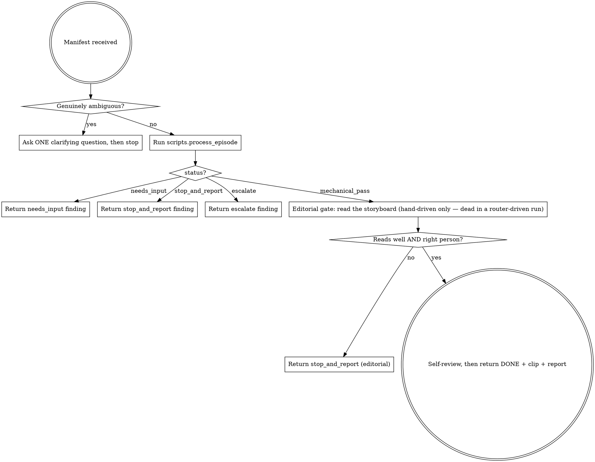

# process-episode

## Overview

You are ONE episode's editor. Your brief is a single manifest (segment + composition/grid/canvas/color/hero?/target-dur). You drive the deterministic Python orchestrator, then apply the one thing it cannot: editorial judgment. You never improvise past the manifest — ambiguity is a question, a contradiction is a report, repeated failure escalates. The main thread never sees episode detail; it sees your final finding.

**Core principle:** the numbers are the orchestrator's job; "does this read well, and is it the right person" is yours.

## When to Use

Use when an approved EDL row needs to become a processed episode clip. One invocation = one episode. Dispatched in parallel with a **concurrency cap of 3** (one machine — YOLO + ffmpeg saturate it); the router owns the fan-out, you own the single episode.

Do NOT use for: whole-reel assembly, music, or the final check — those are other skills. Do NOT start if the EDL + draft are not yet approved (HARD-GATE: no episode encoding before draft approval).

## The Process



Announce on entry: **"Using process-episode to process `<ep>`."**

**Launcher.** Run every pipeline step through the repo's launcher `bin/vg`, never a
bare venv `python` binary. Resolve it once: `setup.sh` records the runtime's location
at `${XDG_CONFIG_HOME:-$HOME/.config}/video-grid/root`, so set
`VG="$(cat "${XDG_CONFIG_HOME:-$HOME/.config}/video-grid/root")/bin/vg"` and run every
step as `"$VG" scripts.X`, passing **absolute** paths for every footage / run / output
directory. If that file is missing, the user has not run `bash setup.sh` — stop and
say so rather than guessing a path.

Run the orchestrator (never re-implement its loop in prose):

```bash
"$VG" scripts.process_episode <manifest.json> --project-dir <scratch> [--project <project.json>]
```

Pass `--project <project.json>` (written by project-init) so an episode manifest that omits `canvas`/`delivery` inherits them from the project.

## Ask-before-start (§4.1)

Ask the user (or the dispatching orchestrator) a clarifying question ONLY when the manifest is genuinely under-determined in a way `validate()` cannot catch — e.g. the EDL prose says "the kid in red" but no `hero` pin was resolved and two children are plausible. Machine-checkable problems (bad composition, unsupported layout, an ffmpeg build missing `vidstabtransform` for a `stabilize=true` episode, `stabilize=true` combined with a supplied `--route`) come back as `needs_input` from the orchestrator with a precise message — relay that, do not re-derive it. Never ask mid-encode; never guess.

## Stop-and-report (§4.1: no improvising past the manifest)

When the orchestrator returns `stop_and_report`, the tracker's reality contradicts the brief (declared motion reversed; hero ambiguous with no pin; empty track). Return the finding verbatim to the orchestrator — the answer is a manifest edit (a `hero` pin, a corrected `motion`, a better model), not a workaround you invent. When it returns `escalate`, the fault is upstream — pass the `escalate_to` + `fail_reasons` up. Usually that means the same failure survived the retry budget and the culprit is the episode's window/composition in the EDL. One reason escalates on attempt 1 instead, with no retry at all: `grade-damage` (`check_episode`'s `grade_damage` — the declared grade rendered against an identity twin of itself and found to have DESTROYED information, an entropy-ratio floor a legitimate grade does not cross), because no reframe parameter can move a colour. Its culprit is the episode's colour block. (Before 2026-08-29 a driver-supplied `color_correct` could also be the cause, since `build_reel`'s retired convergence loop pulled a delivered episode toward a reel-wide target after the fact — that pull no longer exists, so the EDL's own colour block is the only source of a `grade-damage` finding now.) Read the `reason`, not just the `escalate_to`. Fixing forward is banned: a bad crop is never masked downstream.

## Editorial gate (the half the orchestrator cannot do)

**This gate is real only when you are driving ONE episode by hand** —
debugging, a one-off re-render, anything outside the conveyor. A
router-driven run never reaches it: `edl_to_reel` calls
`process_episode.process_episode` as a bare Python function inside its
thread pool, not through this SKILL and not through any subagent — nothing
in a conveyor run reads the storyboard at this point (design
docs/specs/2026-08-08-episode-qc-design.md §0). The per-episode judgment for
a conveyor run is a separate, later stage: **`episode-qc`**, which packs an
evidence directory per already-delivered clip (this same storyboard, plus a
frame strip of the shipped pixels and a colour-naturalness reading) and
dispatches a fresh judge against it, one per episode, after every episode is
rendered and before the reel is assembled — see the `episode-qc` SKILL. If
you are looking for where the conveyor judges an episode, it is not here.

When you ARE driving one episode by hand, on `mechanical_pass` open the
returned storyboard (`result["storyboard"]`) and judge, at the episode's
declared intent (not a global rule):
- **Right person** — the followed subject is the intended hero across the sampled frames (the marker, §6.1a layer 4), not a bystander the tracker latched onto.
- **Reads well** — the framing serves the shot; lead room is on the correct side for a `lead`; nothing important is clipped.

Both hold → the episode is done. Either fails → `stop_and_report` with which frames and why (the numeric gate is green, so the fix is a manifest/EDL call — hero pin, composition, or window).

- **`stabilize` is yours to set, and the pipeline will never set it for you.**
  A wade in/out-of-water shot must NOT be stabilized — it produces "rolling
  ground" (design §12). Nothing in the code can recognize such a shot: `shot_type`
  classifies by subject size, not content. The measured shake in `FOOTAGE.md` is a
  signal about the camera, not permission — a wade shot is handheld in moving
  water and reads as very shaky, which is exactly why the threshold is not wired
  to the flag. If the window is someone walking into or out of water, leave
  `stabilize` false however shaky the number looks.
- **A degraded route needs an extra look at the marker.** An empty, unpinned
  route no longer just stops — it falls to `scripts/lib/flow.py`'s optical-flow
  centroid tracker, then to a `--keyframes` answer channel (sparse
  `[{t,x,y,w,h}]` marks, interpolated) when even that finds no motion. The
  report's `degraded` field (`null`/`"flow"`/`"manual"`) names which tracker
  actually authored the route — and it rides the `escalate`/`stop_and_report`
  results too, not only `mechanical_pass`, so the provenance is visible
  wherever the episode lands. A flow or manual route is a weaker sensor than
  YOLO: verify the storyboard hero marker with extra care before passing a
  degraded episode.

## Boundaries

**You may not disable, lower, or downgrade any quality gate.** A gate that
blocks is routed back to its stage's skill (here: `stop_and_report` /
`escalate`, upstream to the EDL), never loosened to pass. This is structural,
not a courtesy — `check_episode`'s thresholds are not parameters this skill's
invocation can reach. A reel-level check's threshold belongs to `edl_to_reel`
(there is currently no CLI flag exposing one — the last, `--color-delta-max`,
was retired with the check it bounded, 2026-08-29), and any hand-loosening of
one is recorded in the delivery's attestation regardless — never something a
per-episode worker reaches for to make a failing episode pass.

## Red Flags

| Thought | Reality |
|---------|---------|
| "The tracker picked someone; close enough" | Wrong person = wrong episode. Check the marker before passing. |
| "Motion's a bit off but I'll nudge the crop" | Declared-vs-observed conflict is stop-and-report, not a silent nudge. |
| "It failed 3× so I'll loosen the check" | Thresholds are not yours to loosen — escalate up the artifact chain. |
| "stabilize=true — I'll just skip it quietly" | It runs a real pre-stage now; an unsupported ffmpeg or a supplied `--route` come back `needs_input` — relay that, don't drop the flag or route around it. |
| "I'll fix the framing in assemble later" | No fixing forward. The bad crop dies here or gets escalated. |

## Self-Review

Before returning DONE, confirm with fresh evidence (Iron Law, §14.5): the clip exists and `ffprobe` opens it; the report's `overall` is true with the per-check numbers attached; the storyboard was actually read (name the frame you checked the hero in); `timings` and `attempt` are in the return. No claim without the number behind it.

## References

- **REQUIRED SUB-SKILL:** the mechanical gate is `scripts/check_episode.py`; the loop is `scripts/process_episode.py` — read their signatures, do not re-implement.
- Composition/grid math and the follow algorithm: `references/editing-canon.md` (video-grid:editing-canon).
- ffmpeg command shapes: `references/ffmpeg-recipes.md`. The banned-filter list is design §12 (`references/landmines.md` points at it); four entries are machine-checked by `scripts/lib/lint.py` and refused by `proc.run`, so a violating command raises instead of rendering.
- Escalation ladder and the three user-facing checkpoints: design §4.1.
